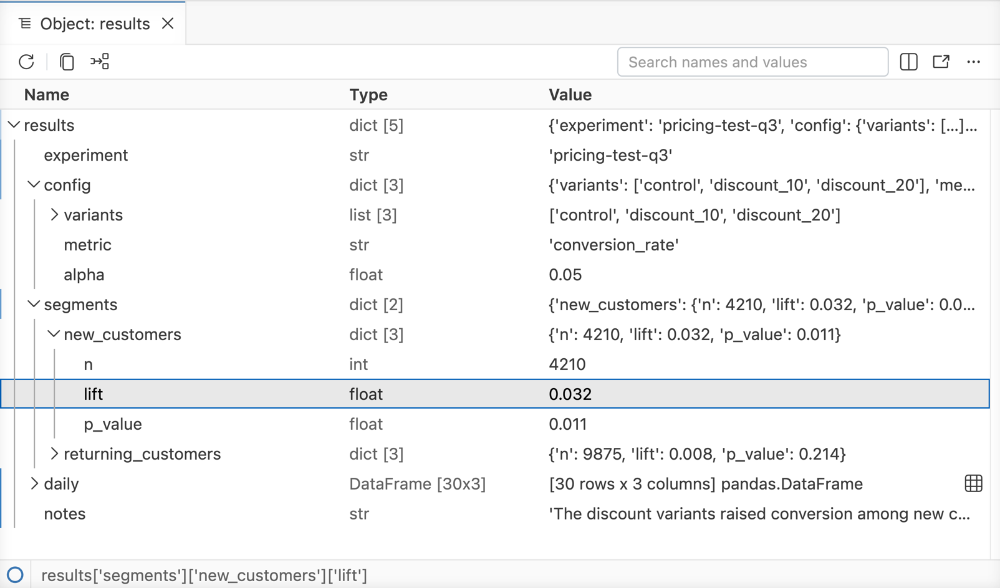
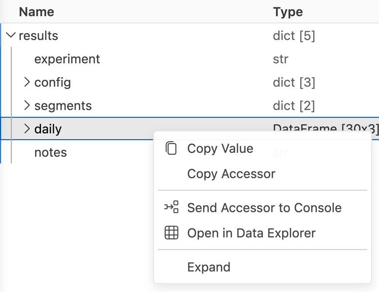
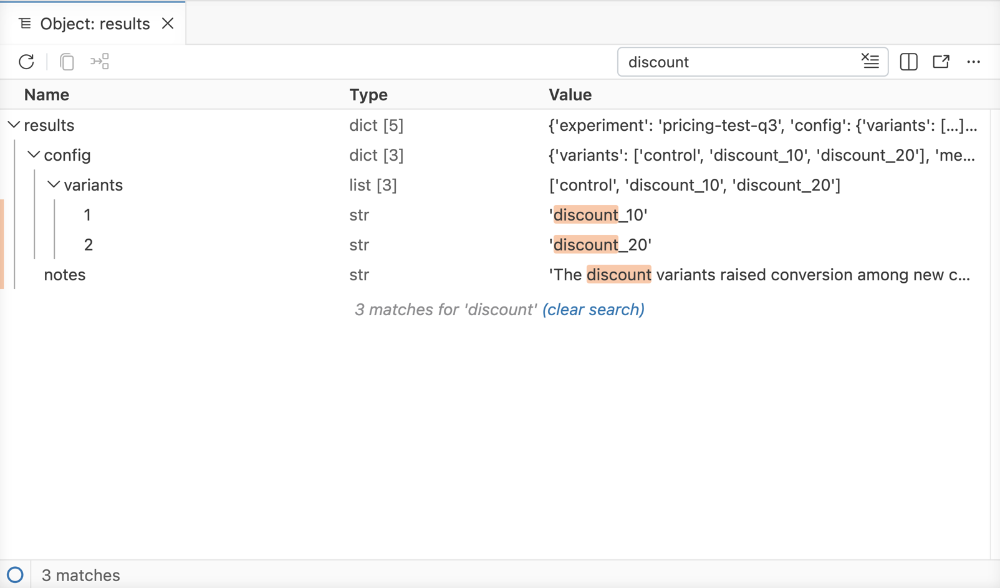

# Object Explorer

Browse, search, and copy code for nested data such as R lists, model fits, Python dicts, and JSON files in a searchable tree.

The Object Explorer is the [Data Explorer](data-explorer.llms.md)’s counterpart for data that is not rectangular. It shows nested data, such as R lists, model fits, Python dicts, and JSON files, as a tree with **Name**, **Type**, and **Value** columns. You can search the whole object, open nested data frames in the Data Explorer, and get the code that selects any value in it.

Object Explorer

## Opening the Object Explorer

There are several ways to open the Object Explorer for an object in your Python or R session:

- In the [**Variables** pane](variables-pane.llms.md), select the **Open in Object Explorer** button next to the variable.
- In Python, run `%view x`. In R, run `View(x)`. You can pass an expression instead of a variable, and an optional title, just as you can for data frames.
- In the editor, place your cursor on a variable and use the **Open ‘*name*’ in Object Explorer** code action from the icon in the editor gutter or the menu.

`View()` and `%view` open data frames in the Data Explorer and other objects in the Object Explorer. The **Variables** pane shows the **Open in Object Explorer** button only for objects that are most useful to explore this way:

|  | Variables pane button | `View()` or `%view` |
|----|----|----|
| Python | Non-empty dicts and other mappings, lists, and tuples | Also other objects with attributes or elements, such as sets and class instances |
| R | Lists, environments, and S4 and S7 objects that have elements, and character vectors with more than one element or a single long string | Also any atomic vector, pairlist, or expression vector |

Each Object Explorer tracks the variable you opened it on. When you change the variable, the Object Explorer updates to show its new value. When you delete the variable, or the session ends, the Object Explorer tells you the object is no longer available. Objects opened from an expression rather than a variable don’t update.

### JSON files

To open a JSON file in the Object Explorer, right-click it in the File Explorer and select **Open in Object Explorer**. JSON files open in the text editor by default; when one is open, the **Open in Object Explorer** button in the editor action bar switches to the Object Explorer.

When you view a JSON file, the **Import Data** button opens the [Import Data](import-data.llms.md) dialog, which generates the code to load the file into a Python or R session.

### Inline in notebooks and Quarto documents

In [Positron notebooks](positron-notebook-editor.llms.md) and [Quarto inline output](quarto-inline-output.llms.md), nested output, such as an R list or a Python dict, appears as a small inline Object Explorer instead of plain text. Select **Open in Object Explorer** to open it in a full editor. Flat data, such as the Python list `[1, 2, 3]` or an R vector, still shows as plain text.

## Navigating the tree

The root of the tree is the object itself. Select the arrow next to a row, or double-click it, to expand or collapse it.

Each row shows the element’s name or index, its type, and a summary of its value. If a name, type, or value is too long to fit, hold the pointer over it to see the full text. When you select a row whose value doesn’t fit, the row expands to show more of the value. For long text, select the button in the expanded row to open the full value in a new editor.

Positron loads large objects one level and 1,000 elements at a time, so even large or deeply nested objects open quickly. When an element has more children than Positron has loaded, select the **Show more** row at the end of its children to load the next page.

As you scroll through deeply nested data, the rows of the expanded parents stick to the top of the tree so you can see where you are. You can resize the **Name** and **Type** columns by dragging the borders between the column headers.

The Object Explorer stops expanding at a depth of 10 levels. Rows at that depth show an ellipsis; hold the pointer over it to see why. To change the depth, set [`objectExplorer.maxDepth`](positron://settings/objectExplorer.maxDepth). The same limit applies to searches.

## Accessors

Selecting a row shows the row’s *accessor* in the status bar at the bottom of the Object Explorer. The accessor is the code that selects that value from the object, such as `fit[["coefficients"]]["wt"]` in R or `results['segments']['new_customers']['lift']` in Python. It’s a quick way to get from finding a value to using it in your code.

The accessor uses the same syntax you write by hand:

- **Python:** `['key']` for dict keys, `[0]` for list and tuple elements, and `.name` for attributes.
- **R:** `[["name"]]` for list elements, `["name"]` for elements of atomic vectors, `[[1]]` or `[1]` for unnamed or duplicated names, `[, 1]` for matrix columns, `$name` for R6 fields, and `@name` for S4 slots and S7 properties.

Some values have no accessor, such as private fields of R6 objects. JSON files have accessors that select values from the parsed file, but you can’t send them to the console because no session holds the file.

To use the accessor:

- Select **Copy Accessor** from the context menu or press to copy it.
- Select **Send Accessor to Console** from the context menu or the action bar to paste it into the console input. Positron doesn’t run it, so you can edit it first, for example to assign it to a variable.

## Context menu and action bar

Right-click a row, or press , to open its context menu.

Object Explorer context menu

The context menu has these actions:

- **Copy Value:** Copy the full value as text.
- **Copy Accessor:** Copy the [accessor](#accessors).
- **Send Accessor to Console:** Paste the accessor into the console input.
- **Open Text in Editor:** For strings, open the full text in a new editor.
- **Open in Data Explorer:** For data frames, open the data frame in the [Data Explorer](data-explorer.llms.md). You can also select the button at the end of the row.
- **Expand** or **Collapse:** Expand or collapse the row.

The action bar at the top of the Object Explorer has buttons for the selected row’s most common actions, including **Refresh**, **Copy Value**, and **Send Accessor to Console**. Depending on the value, it also shows **Open in Editor** or **Open in Data Explorer**.

## Search

Use the **Search names and values** box in the action bar, or press , to search the whole object, including parts you haven’t expanded.

Object Explorer search results

Search is case-insensitive and matches text anywhere in a name or value. Values match only for elements with no children, so a list doesn’t match because of its summary. For strings, the search covers the full text, even when the row shows a truncated value.

The results show each match along with the parents that lead to it, with the matching text highlighted. A footer shows the number of matches. A search stops early if it finds 1,000 matches or runs for too long, and the footer tells you when that happens.

Your Python or R session runs the search, so it can take a moment for large objects. To clear the search and return to the full tree, press EscapeEscape in the search box or select **(clear search)** in the footer. The tree comes back with the same rows expanded as before.

## Keyboard navigation

You can navigate the Object Explorer with the keyboard:

| Key | Action |
|----|----|
| UpUp / DownDown | Move to the previous or next row |
| RightRight | Expand the row, or move to its first child if it’s already expanded |
| LeftLeft | Collapse the row, or move to its parent if it’s already collapsed |
| EnterEnter or SpaceSpace | Expand or collapse the row, or load more rows on a **Show more** row |
| PageUpPageUp / PageDownPageDown | Move up or down by one page |
|  / | Move to the first or last row |
|  | Copy the value |
|  | Copy the accessor |
|  | Open the context menu |
|  | Search |
