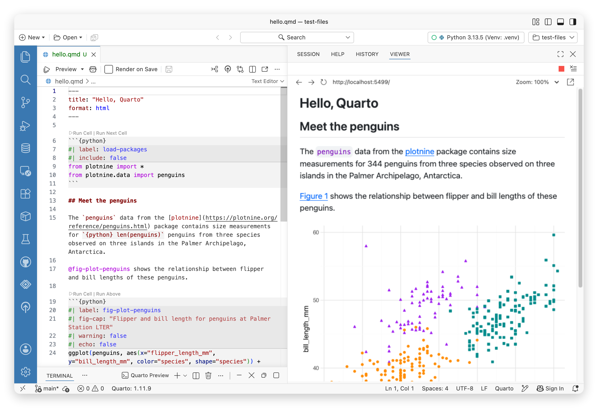

[Quarto](https://quarto.org/) is an open-source scientific and technical publishing system for creating reproducible documents that combine narrative and executable code.

Positron enhances how you can use Quarto in several important ways:

- Quarto works out of the box in Positron. The Quarto CLI is bundled in Positron, and the Quarto extension is included as a [bootstrapped extension](extensions.qmd#bootstrapped-extensions).
- Features such as statement execution work seamlessly in Positron's Console, and Positron supports integrated rendering and preview of Quarto documents.
- Positron provides rich UI via [custom action bars](action-bars.qmd) to preview your Quarto document, control rendering behavior, and switch between source and visual mode.
- Positron can optionally display cell output directly in the source editor; see [Inline Output](quarto-inline-output.qmd) for details.

{width=700}

Learn more in the Quarto documentation about [getting started with Quarto and Positron](https://quarto.org/docs/get-started/hello/positron.html), or [the details of using Positron as a tool for working with Quarto](https://quarto.org/docs/tools/positron/).

:::{.callout-note}
Quarto's [visual editor](https://quarto.org/docs/tools/positron/visual-editor.html) has limited support in Positron. It is a great fit for rich text authoring, but statement execution and other language features are not supported. Consider switching to source mode when you need such features, and [follow along on GitHub for updates](https://github.com/posit-dev/positron/issues/1805) on this support.
:::

## AI actions {#quarto-ai-actions}

Positron integrates with [Posit Assistant](assistant.qmd) to help you write and improve Quarto documents. To use AI actions, first [set up a language model provider](assistant-getting-started.qmd). Then select the **Ask Assistant** icon button in the Quarto editor action bar to open the Assistant panel for your document.

From the panel, you can ask Posit Assistant to **Explain This Document**, **Fix Errors and Issues**, or **Improve This Document**. These actions work with all parts of your document, including prose, code chunks, chunk options, and YAML front matter.



The new chat includes your Quarto document as context.

AI actions work whether or not you use [inline output](quarto-inline-output.qmd). With inline output turned on, Posit Assistant can also run chunks and read their output. The editor [follows the edits it makes](quarto-inline-output.qmd#follow-assistant-edits), and you can [fix and explain chunk errors](quarto-inline-output.qmd#quarto-fix-and-explain).

Positron hides the **Ask Assistant** button when [`ai.enabled`](positron://settings/ai.enabled) is `false`. See [Configure AI features](ai-configuration.qmd) for other ways to turn AI features on and off.

## Support for R Markdown

Quarto provides Positron's support for [R Markdown](https://rmarkdown.rstudio.com/); there is limited specialized IDE support for R Markdown other than what is provided by Quarto. Some advanced `.Rmd` features like using `params` are not supported for interactive use. 

Positron's [Command Palette](command-palette.qmd) does provide commands for working with R Markdown: 

- _R: Render Document With R Markdown_ renders an `.Rmd` file using the R package [rmarkdown](https://pkgs.rstudio.com/rmarkdown/) instead of Quarto. This approach _does_ support all `.Rmd` features but does _not_ automatically open a preview of the rendered output.
- _R: New R Markdown from Template_ creates a new `.Rmd` file from an [R Markdown template](https://rstudio.github.io/rstudio-extensions/rmarkdown_templates.html) available in an installed R package, such as the GitHub flavored markdown template or the flexdashboard templates.

## Using the Quarto extension

The Quarto extension is included as a [bootstrapped extension](extensions.qmd#bootstrapped-extensions) in Positron. This means that it will behave just like you installed it yourself; this extension will update automatically when a new version is available from the [extension gallery](extensions.qmd#extension-gallery) and it can be uninstalled if desired.

## Managing Quarto installations

Positron bundles a version of the Quarto CLI, but you can also use a version of the Quarto CLI that you have installed yourself. This should typically work automatically, but you can manage exactly which Quarto to use via the [`quarto.path`](positron://settings/quarto.path) setting. Check the bottom status bar to see which version of Quarto is being used currently.[^1]

[^1]: If you change the version of Quarto you are using, you will need to restart Positron to see the status bar update.
